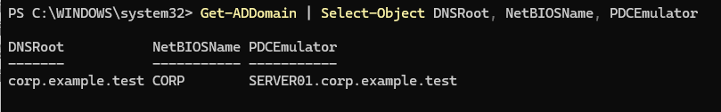

# Windows Server 2025 Active Directory Home Lab

## Project Overview

This project documents the deployment and administration of a virtualized Windows Server 2025 environment designed to simulate common Help Desk and Systems Administration tasks.

The goal is to develop practical experience with Windows Server, Active Directory Domain Services (AD DS), DNS, networking, user account management, and troubleshooting.

**Project Status:** In Progress

## Technologies Used

- Oracle VirtualBox
- Windows Server 2025
- Active Directory Domain Services (AD DS)
- Windows DNS Server
- Windows PowerShell
- Windows 11 (host operating system)

## Lab Environment

| Component | Configuration |
|---|---|
| Hypervisor | Oracle VirtualBox |
| Server | SERVER01 |
| Operating System | Windows Server 2025 |
| Active Directory Domain | corp.example.test |
| NetBIOS Domain | CORP |
| Internal Network | CorpLab |
| Domain Controller IP | 192.168.50.10/24 |
| Server Memory | 6 GB |
| Virtual CPUs | 2 |
| Virtual Disk | 80 GB |

### Network Architecture

The server uses two virtual network adapters:

- **Adapter 1 (NAT):** Provides internet connectivity.
- **Adapter 2 (Internal Network):** Provides an isolated network for future domain-joined clients.

The internal network uses the `192.168.50.0/24` subnet, with the domain controller configured at `192.168.50.10`.

## Completed Configuration

### 1. Windows Server Deployment

- Created and configured the SERVER01 virtual machine.
- Installed Windows Server 2025.
- Configured the server hostname.
- Verified network connectivity.

### 2. Active Directory and DNS

- Installed the Active Directory Domain Services role.
- Created the `corp.example.test` forest and domain.
- Promoted SERVER01 to a domain controller.
- Configured the DNS Server role.
- Verified domain functionality using PowerShell.
- Tested DNS resolution and diagnostics.
  
### Active Directory Domain Verification

Verified the Active Directory domain configuration using the PowerShell `Get-ADDomain` command.

The results confirm the domain name, NetBIOS name, and Primary Domain Controller (PDC Emulator).



This exercise demonstrates the ability to inspect and validate Active Directory domain configuration using PowerShell.

### 3. Organizational Unit Management
#### Active Directory Organizational Unit Structure

The screenshot below demonstrates the organizational unit structure created within the `corp.example.test` domain.


The `Company` OU contains separate organizational units for users, computers, and security groups. This structure provides a foundation for centralized account administration and future Group Policy configuration.

Created the following Active Directory structure:

```text
corp.example.test
└── Company
    ├── Users
    ├── Computers
    └── Security Groups
```

### 4. User and Security Group Management

- Created a sample employee account: Alex Morgan (`amorgan`).
- Created the `HelpDesk-Tier1` global security group.
- Added the employee account to the security group.
- Verified group membership through Active Directory Users and Computers.
  
### Security Group Membership Verification

Created the `HelpDesk-Tier1` global security group and assigned the sample employee account Alex Morgan as a member.

Verified the group membership using Active Directory Users and Computers.

This exercise demonstrates user access administration, security group management, and verification of account membership in an Active Directory environment.


## Planned Help Desk Simulations

- [ ] Password reset and account recovery
- [ ] Account lockout troubleshooting
- [ ] Windows client domain join
- [ ] Group Policy configuration
- [ ] Shared folder permissions
- [ ] Additional DNS and connectivity troubleshooting

## Skills Demonstrated

- Windows Server installation and configuration
- Active Directory administration
- DNS configuration and troubleshooting
- Virtual networking
- User provisioning
- Security group management
- PowerShell-based verification
- Technical documentation

## Project Purpose

This lab is part of my professional development toward an entry-level IT Help Desk position, with long-term goals in Systems Administration and Cybersecurity.

The environment will continue to expand as I complete additional administrative tasks, troubleshooting exercises, and security-focused projects.
